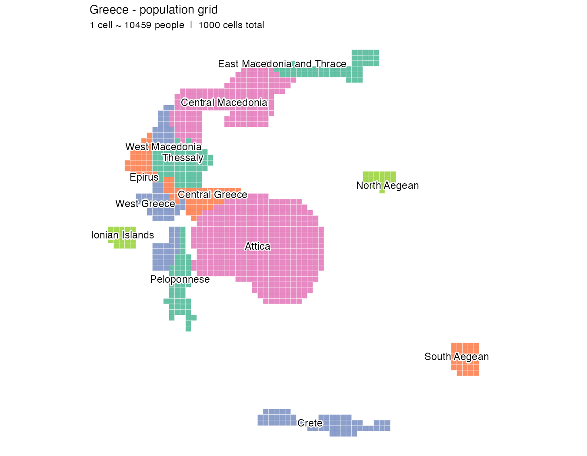

# popgridR

popgridR draws mosaic cartograms, maps of equal squares where every square
stands for the same amount (people, trips, euros). Regions are deformed to
match their weights and then filled with cells. Hamilton allocation fixes
each region's cell count in advance, so the counts are exact even when the
shapes are not. `popgrid()` returns the cells as `sf` for you to plot.

It is an R port of [popgrid](https://github.com/databites-tech/popgrid) by
[Josep Ferrer](https://github.com/iamjosepferrer), written largely with
Claude Code. It takes any `sf` polygons and numeric weights instead of
country codes, and leaves out the Python package's plotting. It is a
development version, not on CRAN.

## Installation

```r
devtools::install_github("gkaramanis/popgridR")

# Optional. Adds the faster deformation methods written in C.
install.packages("cartogramR")
```

## Usage

```r
library(popgridR)
library(sf)
library(ggplot2)

regions <- read_sf("regions.gpkg")

cells <- popgrid(
  regions,
  values     = "weight",   # a column name, a named vector or one value per row
  region_col = "region",
  n          = 500         # total cells; or value_per_cell = 50000
)

ggplot(cells) +
  geom_sf(aes(fill = region), color = NA) +
  theme_void()

# What one cell stands for
attr(cells, "value_per_cell")

# Cells per region
attr(cells, "quotas")
```

## Example: Greece

The boundaries come from Natural Earth through `load_country_regions()`,
which needs rnaturalearth. The plot also uses ggrepel and RColorBrewer. The population figures are from the 2021 ELSTAT
census. The same script is in `inst/examples/greece.R`.

```r
library(popgridR)
library(ggplot2)

# Natural Earth's admin-1 regions for Greece are the 13 peripheries
regions <- load_country_regions("GRC")

# Mount Athos is too small to get a cell at n = 1000
regions <- regions[regions$region_name != "Mount Athos", ]

population <- c(
  "Attica"                    = 3814064,
  "Central Macedonia"         = 1795669,
  "Thessaly"                  =  688255,
  "West Greece"               =  643449,
  "Crete"                     =  624408,
  "East Macedonia and Thrace" =  562201,
  "Peloponnese"               =  539535,
  "Central Greece"            =  508254,
  "Epirus"                    =  319991,
  "South Aegean"              =  309015,
  "West Macedonia"            =  254595,
  "Ionian Islands"            =  204532,
  "North Aegean"              =  194943
)

cells <- popgrid(regions, values = population, n = 1000)

# Five ColorBrewer Set2 colours, assigned by hand so that no two
# neighbouring regions share one. Labels name the regions.
set2 <- RColorBrewer::brewer.pal(5, "Set2")

region_colour <- c(
  "Thessaly"                  = set2[1],
  "East Macedonia and Thrace" = set2[1],
  "Peloponnese"               = set2[1],
  "Central Greece"            = set2[2],
  "Epirus"                    = set2[2],
  "South Aegean"              = set2[2],
  "West Greece"               = set2[3],
  "West Macedonia"            = set2[3],
  "Crete"                     = set2[3],
  "Central Macedonia"         = set2[4],
  "Attica"                    = set2[4],
  "Ionian Islands"            = set2[5],
  "North Aegean"              = set2[5]
)

blocks <- aggregate(cells["region_name"], by = list(region = cells$region_name), FUN = \(x) x[1])

ggplot(cells) +
  geom_sf(aes(fill = region_name), color = "white", linewidth = 0.1) +
  ggrepel::geom_text_repel(data = blocks, aes(label = region, geometry = geometry), stat = "sf_coordinates", fun.geometry = sf::st_point_on_surface, size = 4, bg.color = "white", bg.r = 0.15, min.segment.length = Inf, point.size = NA, box.padding = 0.1, seed = 1) +
  scale_fill_manual(values = region_colour, guide = "none") +
  theme_void() +
  labs(
    title    = "Greece - population grid",
    subtitle = sprintf("1 cell ~ %.0f people  |  %d cells total",
                       attr(cells, "value_per_cell"), nrow(cells))
  )
```



## Deformation methods

`method` picks how the regions are deformed before they are filled with
cells.

| method     | backend                                 | notes                                         |
|------------|-----------------------------------------|-----------------------------------------------|
| `"auto"`   | `"dcn"` with cartogramR, else `"damped"` | the default                                   |
| `"dcn"`    | cartogramR, Dougenik et al. (1985), C   | fast and converges fully                      |
| `"gn"`     | cartogramR, Gastner and Newman (2004), C | copes better with very uneven weights         |
| `"gsm"`    | cartogramR, Gastner, Seguy and More (2018), C | flow-based successor to `"gn"`, faster |
| `"damped"` | Dougenik in plain R                     | no compiled dependency, slower but stable     |
| `"none"`   | no deformation                          | the input shapes are used as they are         |

The method changes the shapes only. Cell counts are corrected after the
cells are drawn, so every method gives the same counts.

## What `popgrid()` does

It projects the regions to an equal-area CRS, allocates cells, groups the
regions into landmasses, then deforms and fills each landmass. It then
corrects the counts, repairs neighbours so regions touch as on the real map,
fills gaps and puts all cells on one grid. Each step is exported:
`project_regions()`, `detect_landmasses()`, `deform_regions()`,
`generate_cells()`, `fit_quota()`, `enforce_topology()` and `fill_gaps()`.

## Input data

- Runtime grows with the number of polygon parts. Drop islands too small to
  get a cell first.
- Rows sharing a `region_col` value form one region. See `values_agg` for
  how weights are combined.
- Detached territories sit next to the mainland, not in an inset. Filter
  out far-off ones you don't want.

## Limitations

- Runtime depends on the number of vertices, not on `n`. Generalised
  boundaries are quick (Greece at `n = 1000` takes about three seconds), but
  full-resolution official boundaries can take minutes. `simplify = TRUE`
  helps with those and isn't worth it otherwise.
- A region enclosed by another makes the neighbour repair hard. It may use
  up `topology_passes` without settling.
- The Python original is much faster on the same input.

## References

- Dougenik, J. A., Chrisman, N. R., & Niemeyer, D. R. (1985). An algorithm
  to construct continuous area cartograms. *The Professional Geographer*,
  37(1), 75–81.
- Gastner, M. T., & Newman, M. E. J. (2004). Diffusion-based method for
  producing density-equalizing maps. *PNAS*, 101(20), 7499–7504.
- Gastner, M. T., Seguy, V., & More, P. (2018). Fast flow-based algorithm
  for creating density-equalizing map projections. *PNAS*, 115(10),
  E2156–E2164.
- Original Python implementation:
  [databites-tech/popgrid](https://github.com/databites-tech/popgrid) by
  [Josep Ferrer](https://github.com/iamjosepferrer).
